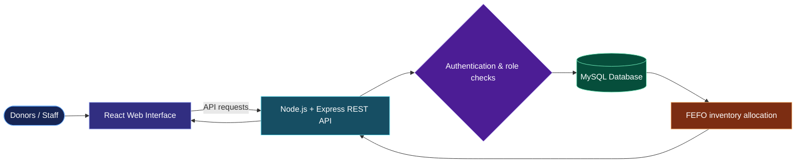

<!-- ✨ PROFILE README — replace the old README.md with this entire file -->

<!-- Animated-style banner rendered by an external SVG service -->

 

---

## ⚡ A little about me

> **Not here to pretend I know everything — I'm here to keep building until I do.**

Hey! I'm **Souti**, a B.Tech Computer Science & Engineering student at **Adamas University** (2024–2028), based in India. I learn best by turning ideas into projects, chasing bugs, and figuring out why things work (or don't 😅).

- 🧑‍🎓 **Currently:** studying CSE and building my project portfolio
- 🧩 **Into:** software development, Python, data analytics, and applied AI
- 🔧 **Learning by doing:** APIs, databases, UI workflows, testing, and debugging
- 🌱 **Looking for:** my first internship, collaborators, and honest feedback
- 💬 **My rule:** ship what works, label what is unfinished, and keep improving

`CURIOUSITY → BUILD → TEST → DEBUG → LEARN → REPEAT`

## 🧰 My toolbox

### Languages

### Web & frameworks

### Data, services & developer tools

These are technologies I've used or explored across projects—not a claim of expert-level proficiency in every tool.

---

## 🚀 Things I've been building

| Project | Current status | The idea |
|:--|:--:|:--|
| 🩸 **[RaktOra](https://github.com/SPradhan-code/RaktOra)** | 🟢 Usable | Blood-network workflows, role-based dashboards, appointments, and FEFO inventory allocation |
| 🗓️ **[Attendance Portal](https://github.com/SPradhan-code/Attendance-Portal)** | 🟡 In progress | Attendance workflows exploring QR codes, location checks, and authentication |
| 📚 **[AI Study Planner](https://github.com/SPradhan-code/AI-StudyPlanner)** | 🔵 Complete | Organizing study plans and learning activities |
| 🧠 **[Snapdragon Edge AI Inspector](https://github.com/SPradhan-code/snapdragon-edge-ai-inspector)** | 🔵 Complete* | Computer-vision inspection workflow using YOLOv8 and ONNX Runtime |
| 📄 **[AI Decoder](https://github.com/SPradhan-code/AI-Decoder-)** | 🧪 Prototype | AI-assisted document and PDF understanding |
| 🎵 **[LED DJ Sync](https://github.com/SPradhan-code/led-bt-sync)** | 🟡 In progress | Exploring music-reactive LED control in the browser |
| 🧹 **[Chat-Cleanser](https://github.com/SPradhan-code/Chat-Cleanser)** | 🧪 Prototype | Cleaning and normalizing exported chat logs with text-processing rules |

🟢 Usable · 🔵 Complete · 🟡 In progress · 🧪 Prototype. *Physical Snapdragon-device performance has not been verified. Chat-Cleanser is a text-cleanup prototype, not a verified toxicity classifier.

### 🩸 RaktOra — how the pieces fit together

Conceptual overview from the project's described features—not a verified production deployment map. The diagram is rendered by GitHub's Mermaid support.

### 🔗 Try the Attendance Portal draft

---

## 🏅 Learning milestones

<b>📊 Deloitte — Data Analytics Job Simulation</b> · June 7, 2026

Completed simulation tasks involving forensic technology and data analytics.

<b>📈 Tata — GenAI Powered Data Analytics Job Simulation</b> · June 12, 2026

Worked through simulation activities involving exploratory data analysis, risk profiling, delinquency prediction, reporting, and an AI-supported collections strategy.

<b>🤖 FutureSkills Prime / Nasscom IT-ITeS SSC — Gen AI Tools</b> · August 22, 2026

Course certificate issued for Gen AI Tools.

<b>🎮 RRR-A Game Jam — Participation</b>

Participation certificate from IIT (ISM) Dhanbad; team `soutipradhan27`, Adamas University.

---

## 📈 My GitHub corner

Stats and language charts are generated by external services and may occasionally be unavailable or delayed. Language percentages reflect repository contents, not skill level.

---

## 🤝 Let's connect

Got an idea, feedback on one of my projects, or an internship opportunity? I'd be happy to hear from you.

 

**Thanks for stopping by ✨**

Still learning. Still building. Always open to useful feedback.

