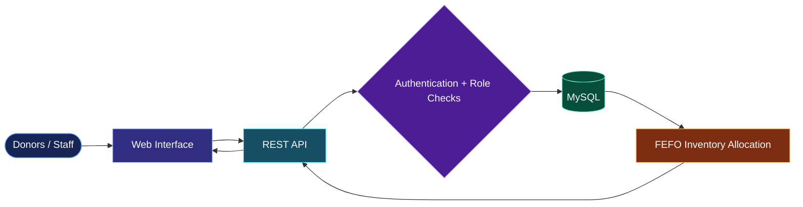

<!--
  SOUTI PRADHAN | GitHub Profile README
  Style direction: neon system-console / navigation portal, inspired by the reference profile's
  layered banner, visual access panels, animated dividers, technology grid, stats, and contact zone.
  All project statuses and claims below are intentionally conservative.
-->

 

<!-- START HERE / PORTAL -->

## ◈ START HERE · PROFILE CONTROL DECK

<table width="100%">
  <tr>
    <td align="center" width="25%">
       
      Who I am
    </td>
    <td align="center" width="25%">
       
      What I'm building
    </td>
    <td align="center" width="25%">
       
      What I use
    </td>
    <td align="center" width="25%">
       
      Say hello
    </td>
  </tr>
</table>

## ◉ ABOUT ME // `profile.info`

<table>
<tr>
<td width="62%" valign="top">

Hey! I'm **Souti Pradhan**, a B.Tech Computer Science & Engineering student at **Adamas University** (2024–2028), based in India.

I'm learning by making things: applications, data workflows, and applied-AI prototypes. I like taking an idea from a rough sketch to something people can try—and learning from the bugs along the way.

- 🎓 **Focus:** Computer Science & Engineering
- 🛠️ **Exploring:** software development, Python, data analytics, applied AI
- 🧪 **My workflow:** build → test → debug → document → improve
- 🌱 **Next goal:** an internship where I can contribute, learn from a team, and grow as an engineer

</td>
<td width="38%" valign="middle" align="center">

</td>
</tr>
</table>

`[ CURIOSITY ]` ━━━▶ `[ BUILD ]` ━━━▶ `[ TEST ]` ━━━▶ `[ DEBUG ]` ━━━▶ `[ LEARN ]` ↺

## 🧭 SYSTEM ACCESS // `project.portal`

<table width="100%">
<tr>
<td align="center" width="50%" valign="top">

### 🩸 RaktOra

**Blood network & FEFO inventory engine**

Role-based dashboards, appointment workflows, and FEFO-oriented blood inventory allocation.

`React` · `Node.js` · `REST API` · `MySQL`

</td>
<td align="center" width="50%" valign="top">

### 🗓️ Attendance Portal

Attendance workflows exploring QR codes, location checks, and authentication.

`Next.js` · `Supabase` · `WebAuthn`

</td>
</tr>
<tr>
<td align="center" width="50%" valign="top">

### 🧠 Snapdragon Edge AI Inspector

Computer-vision inspection workflow built with YOLOv8, ONNX Runtime, and PyQt6.

`Python` · `YOLOv8` · `ONNX Runtime` · `PyQt6`

Actual performance on physical Snapdragon hardware has not been verified.

</td>
<td align="center" width="50%" valign="top">

### 📚 AI Study Planner

A web app for organizing study plans and learning activities.

`React` · `Vite` · `Firebase`

</td>
</tr>
<tr>
<td align="center" width="50%" valign="top">

### 📄 AI Decoder

Prototype for AI-assisted document and PDF understanding.

`Python` · `Streamlit` · `Gemini`

</td>
<td align="center" width="50%" valign="top">

### 🧹 Chat-Cleanser

Text-cleanup prototype for normalizing exported chat logs using rule-based processing.

`Python` · `Text Processing`

Not presented as a verified toxicity classifier.

</td>
</tr>
<tr>
<td align="center" width="50%" valign="top">

### 🎛️ LED DJ Sync

Browser-based exploration of music-reactive LED control.

`Web Audio` · `Web Bluetooth`

</td>
<td align="center" width="50%" valign="top">

### 🧪 More experiments

I keep experimenting with small builds, data workflows, UI ideas, and developer tooling as I learn.

</td>
</tr>
</table>

## 🩸 RAKTORA // SYSTEM FLOW

A conceptual diagram of the described project features; it is not a verified production infrastructure map.

## 🧰 TOOLKIT // `stack.index`

### Languages & data

### Web development

### Platforms & workflow

<blockquote>
  <b>Small print:</b> these are tools I've used or explored in projects. The icon wall is not a claim of expert-level proficiency in every technology.
</blockquote>

## 📡 LEARNING LOG // `credentials.index`

<b>📊 Deloitte — Data Analytics Job Simulation</b> · 7 June 2026

Simulation activities involving forensic technology and data analytics.

<b>📈 Tata — GenAI Powered Data Analytics Job Simulation</b> · 12 June 2026

Simulation activities covering exploratory data analysis, risk profiling, delinquency prediction, reporting, and an AI-supported collections strategy.

<b>🤖 FutureSkills Prime / Nasscom IT-ITeS SSC — Gen AI Tools</b> · 22 August 2026

Course certificate issued for Gen AI Tools.

<b>🎮 RRR-A Game Jam — Participation Certificate</b>

Participation certificate from IIT (ISM) Dhanbad; team `soutipradhan27`, Adamas University.

## 📊 VITAL STATS // `github.telemetry`

Stats are delivered by external services and may occasionally be unavailable or delayed. Repository language statistics indicate file composition, not skill proficiency.

I'm looking for opportunities to **learn with other developers, get constructive feedback, contribute to useful projects, and apply for internships**. I'm especially interested in practical software, data, and applied-AI work.

  

<code>Thanks for visiting — leave a star on a repo if you find it useful ⭐</code>

Still learning. Still building. Always open to useful feedback.

