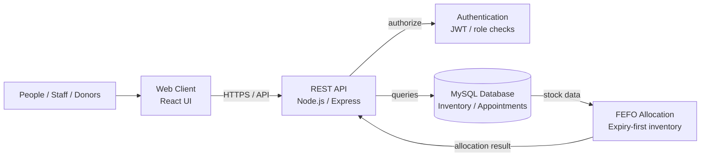

# 👋 Hi, I'm Souti Pradhan

### B.Tech Computer Science & Engineering Student | Student Developer | Exploring Software Development, Data Analytics & Applied AI

I’m a CSE student at **Adamas University** (2024–2028), learning by building practical projects. I’m interested in software development, Python, data analytics, and applied AI. I’m currently looking for my first internship and welcome feedback on my work.

---

## 🧭 About Me

- 🎓 B.Tech CSE, Adamas University (2024–2028)
- 💻 Practising full-stack development, Python, databases, and problem-solving
- 📊 Interested in data analytics and applied AI
- 🧪 Building projects to learn testing, debugging, and application design
- 🤝 Open to internship opportunities, collaboration, and constructive feedback

I label project status honestly: some projects are usable or complete, while others are still in development or are prototypes. Project descriptions below do not claim unverified performance or hardware testing.

## 🛠️ Languages, Tools & Technologies

**Languages:** Python · JavaScript · TypeScript · SQL · C++  
**Web:** React · Vite · Next.js · Node.js · Express  
**Data & AI:** Pandas · NumPy · YOLOv8 · ONNX Runtime  
**Databases & Services:** MySQL · Firebase · Supabase  
**Tools:** Git · GitHub · VS Code · Docker

---

## 🚀 Projects

### 1. [RaktOra](https://github.com/SPradhan-code/RaktOra) — Usable
**Blood network and inventory-management application**

Explores donor workflows, role-based dashboards, appointment workflows, and FEFO (First Expired, First Out) inventory allocation.

**Stack:** React · Node.js · Express · MySQL

#### RaktOra — conceptual system diagram

> This is a simplified conceptual diagram based on the portfolio project's description. It is not a verified production deployment map; update it if the implementation changes.

### 2. [Attendance Portal](https://github.com/SPradhan-code/Attendance-Portal) — In development
Attendance-management project exploring authentication, QR-based attendance, location verification, and faculty workflows.

**Stack:** Next.js · TypeScript · Supabase · WebAuthn  
**Draft deployment:** [Open website](https://attendance-portal-jade.vercel.app)

### 3. [AI Study Planner](https://github.com/SPradhan-code/AI-StudyPlanner) — Complete
Study-planning application built to help organize learning activities and track study progress.

**Stack:** React · Vite · Firebase

### 4. [Snapdragon Edge AI Inspector](https://github.com/SPradhan-code/snapdragon-edge-ai-inspector) — Complete; physical hardware validation pending
Computer-vision inspection application exploring YOLOv8 and ONNX Runtime inference workflows. **Physical Snapdragon-device performance has not been verified.**

**Stack:** Python · YOLOv8 · ONNX Runtime · PyQt6

### 5. [AI Decoder](https://github.com/SPradhan-code/AI-Decoder-) — Prototype
Prototype exploring AI-assisted document understanding and PDF-processing workflows.

**Stack:** Python · Streamlit · Gemini API

### 6. [LED DJ Sync](https://github.com/SPradhan-code/led-bt-sync) — In development
Browser-based project exploring music-beat detection and Bluetooth-connected LED synchronization.

**Stack:** JavaScript · Web Audio API · Web Bluetooth

### 7. [Chat-Cleanser](https://github.com/SPradhan-code/Chat-Cleanser) — Prototype
Python text-processing prototype for cleaning and normalizing exported chat logs. It should not be interpreted as a verified toxicity-classification system.

**Stack:** Python · Regular expressions · Text processing

---

## 📜 Certificates & Activities

- **Deloitte Data Analytics Job Simulation** — completed June 7, 2026; forensic technology and data analytics tasks.
- **Tata GenAI Powered Data Analytics Job Simulation** — completed June 12, 2026; exploratory data analysis, risk profiling, delinquency prediction, reporting, and AI-supported collections strategy.
- **FutureSkills Prime / Nasscom IT-ITeS SSC — Gen AI Tools course** — certificate issued August 22, 2026.
- **RRR-A Game Jam** — participation certificate; IIT (ISM) Dhanbad, team `soutipradhan27`, Adamas University.

---

## 📫 Connect

- **GitHub:** [SPradhan-code](https://github.com/SPradhan-code)
- **LinkedIn:** [Souti Pradhan](https://www.linkedin.com/in/souti-pradhan-42a949273/)
- **Email:** [soutipradhan@gmail.com](mailto:soutipradhan@gmail.com)

---

Built to share projects and learning progress. Project statuses and technical claims are intentionally limited to what has been described and verified.
